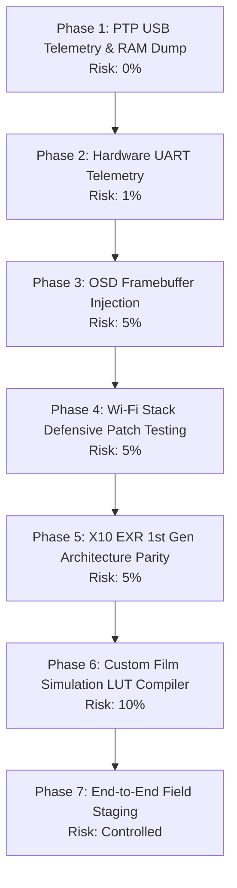

# Fujifilm Custom Firmware Research: Next Steps & Technical Roadmap

This document outlines the sequential next steps for custom firmware development across the **Fujifilm X-T10** (EXR Processor II) and **FinePix X10** (1st Gen EXR Processor).

Steps are strictly ordered by **risk escalation tier**: starting with zero-risk host/PTP operations, advancing through non-destructive hardware telemetry, and concluding with flash payload staging.

---

## Roadmap Overview

---

## Detailed Step Breakdown

### Step 1: Live Memory Telemetry & PTP/USB RAM Dumper
- **Objective:** Read and write camera RAM over standard micro-USB cable in real-time without modifying on-board flash memory.
- **Risk Level:** **0% (Zero Risk)**. Execution and reads happen entirely in volatile DRAM. Rebooting resets the camera to factory state.
- **Key Offsets (X-T10 v1.31):**
  - `FIRM_PTP`: `0x01e7c718` (PTP command dispatcher table).
  - Target Vendor PTP Opcode: `0x9028` / `0x9805` (custom read/write memory opcode).
  - Volatile work buffers: `0x01cf0000 - 0x01cf4000`.
- **Implementation Deliverables:**
  1. Add PTP USB host client script in Python using `pyusb` / `libusb` to send raw PTP packets.
  2. Implement RAM dumper payload that responds to vendor PTP opcode `0x9028` by reading memory at address `[arg1]` for length `[arg2]` and streaming over USB bulk endpoint.
  3. Dump hardware register maps (`0x00000000 - 0x00010000` and `0x40000000+` peripheral space) to map clock gates, GPIO, and UART controllers.
- **Failure Mitigation:** See [docs/BRICK_ANALYSIS_AND_RECOVERY.md#ptp-ram-recovery](BRICK_ANALYSIS_AND_RECOVERY.md#ptp-ram-recovery). If execution hangs, simply pull the battery. DRAM is 100% volatile and the camera reboots into stock firmware without flash wear.
- **Status:** **IMPLEMENTED** in `core/ptp.py` and `tools/fuji_ptp.py`. Verified in `tests/test_ptp.py`.
---

### Step 2: Physical Hardware UART Discovery & Logic Analyzer Logging
- **Objective:** Tap the camera's internal debug serial console for live kernel panic logs and RTOS assertions.
- **Risk Level:** **1% (Very Low)**. Requires opening the camera bottom/back shell with non-conductive tools and probing test pads with high-impedance logic analyzer probes.
- **Background Evidence in Firmware:**
  - Diagnostic strings in `xt10_v131.bin`: `[CTRL] GetDlId : ERR`, `STM AP_SOC Halt.`, `lanInit:efTcpIpInit Error.`.
  - Serial baudrate in Fujitsu/Fujifilm EXR platforms is standard **115200 bps 8N1** (3.3V logic level).
- **Implementation Deliverables:**
  1. Disassemble the bottom plate of a donor/test X-T10.
  2. Locate unpopulated 3-pad or 4-pad test headers (`TP_TX`, `TP_RX`, `GND`) near the main SoC or SD card daughterboard.
  3. Connect logic analyzer / 3.3V FTDI serial adapter; capture boot output and Wi-Fi initialization logs.
- **Failure Mitigation:** See [docs/HARDWARE_TELEMETRY_AND_RECOVERY.md](HARDWARE_TELEMETRY_AND_RECOVERY.md#section-1-hardware-uart-telemetry-tapping). Always use 3.3V LVCMOS (never 5V TTL) with current-limiting resistors to protect SoC I/O.
- **Status:** **DOCUMENTED** in `docs/HARDWARE_TELEMETRY_AND_RECOVERY.md`.
---

### Step 3: OSD Framebuffer Reverse Engineering (Zebra, Peaking, Grids)
- **Objective:** Render real-time graphics (custom framelines, zebra stripes, false color, custom battery percentage) on the rear LCD and EVF.
- **Risk Level:** **5% (Low)**. Overwrites display memory; no persistent flash writes.
- **Key Offsets (X-T10 v1.31):**
  - OSD Debug routine: `0x007f9c1c` (`OSD DEBUG MODE SCREEN SELECT`).
  - Virtual display buffer descriptor: `0x01b59bd4`.
  - Display resolution: 640×480 RGB565 / YUV422 packed (307,200 bytes per buffer).
- **Implementation Deliverables:**
  1. Decompile `0x007f9c1c` to identify the graphics context structure (stride, pitch, double-buffer pointer).
  2. Develop `payloads/osd_overlay/`: ARMv7-A payload that draws a test pattern (1px border or crosshair) over the liveview buffer.
  3. Validate through memory injection via PTP (Step 1).

---

### Step 4: Wi-Fi KASAGO Patch Integration & Controlled Testing
- **Objective:** Verify that the defensive patch in `core/wifi_patch.py` prevents camera freeze when connected to Android 14+/iOS 18 devices.
- **Risk Level:** **5% (Low)**. Uses the secondary cold-hook trampoline in non-critical memory.
- **Action Plan:**
  1. Unpack `FWUP0007.DAT` with `fujitool unpack`.
  2. Apply `WiFiPatcher.apply_patch()` to replace the vulnerable static buffer copy in the DHCP/SSDP socket receiver with bounds-checked instructions.
  3. Repack with `fujitool repack --increment-version`.
  4. Test on physical camera: verify the camera accepts the `.DAT` file on SD card (`DISP/BACK` held during power on), connects to modern phone, and streams photo transfers without freezing.

---

### Step 5: FinePix X10 (1st Gen EXR) Architecture Parity
- **Objective:** Bring the FinePix X10 tools and docs to complete parity with the X-T10.
- **Risk Level:** **5% (Low)**.
- **Differences from X-T10:**
  - Architecture: **ARMv5TE** (32-bit ARM9/ARM11 core) instead of ARMv7-A Cortex.
  - Sensor: 2/3-inch Bayer EXR-CMOS with mechanical rotary switch on zoom ring (turning the barrel powers the camera).
  - Firmware format: Type 2 / 128-byte header (`FPUPDATE.DAT`, v2.01).
- **Implementation Deliverables:**
  1. Extract color matrices from X10 v2.01 binary (`FPUPDATE.DAT`) for the 2/3" sensor.
  2. Port `payloads/` build pipeline to target `-march=armv5te` (already supported in `payloads/Makefile`).
  3. Map the power-on hardware routine triggered by lens rotation.

---

### Step 6: 3D-LUT and Custom Film Simulation Profile Compiler
- **Objective:** Create a compiler that takes standard `.cube` 3D-LUT files or Adobe Lightroom camera profiles and compiles them into Fujifilm DSP format.
- **Risk Level:** **10% (Medium)**.
- **Pipeline Details:**
  - 3x3 color matrix transformation (RGB -> intermediate gamut, Q15 fixed-point).
  - 1D tone curves for Highlights and Shadows (256-point / 512-point spline tables).
- **Implementation Deliverables:**
  1. Tool `tools/lut_to_fuji.py`: converts 17x17x17 or 33x33x33 `.cube` LUTs into the closest 3x3 matrix + 1D spline curves.
  2. Inject profiles for **Classic Negative**, **Eterna Bleach Bypass**, and **Nostalgic Neg** into unused DSP memory blocks.
- **Failure Mitigation:** See [docs/COLOR_PIPELINE.md](COLOR_PIPELINE.md) and [docs/BRICK_ANALYSIS_AND_RECOVERY.md#firmware-level-recovery](BRICK_ANALYSIS_AND_RECOVERY.md#firmware-level-recovery). Matrix fitting clamps Q15 coefficients and falls back to standard Provia matrix on divergence.
- **Status:** **IMPLEMENTED** in `core/lut_compiler.py` and `tools/lut_compiler.py`. Verified in `tests/test_lut_compiler.py`.
---

### Step 7: Safe Hardware Testing & Debricking Bench Setup
- **Objective:** Ensure physical recovery hardware is operational before any non-volatile flash modifications.
- **Mandatory Bench Equipment:**
  - **Programmer:** CH341A / Raspberry Pi / Bus Pirate with `flashrom`.
  - **SOIC-8 Clip (Pomona 5250):** For in-circuit reading/flashing of 3.3V SPI flash chips without desoldering.
  - **Adjustable DC Power Supply (9V dummy battery):** Prevents power loss during write operations.
- **Checklist:**
  - [ ] Complete flash dump backed up to 3 offline locations.
  - [ ] In-circuit read verified byte-for-byte identical over 3 consecutive reads.
  - [ ] Emergency bootloader partition (`0x00000000 - 0x00010000`) confirmed write-protected.
- **Failure Mitigation:** See [docs/HARDWARE_TELEMETRY_AND_RECOVERY.md#section-2-in-circuit-spi-flash-dumping--debricking](HARDWARE_TELEMETRY_AND_RECOVERY.md#section-2-in-circuit-spi-flash-dumping--debricking) and [docs/BRICK_ANALYSIS_AND_RECOVERY.md#level-3-hard-brick--recovery](BRICK_ANALYSIS_AND_RECOVERY.md#level-3-hard-brick--recovery).
- **Status:** **DOCUMENTED** with complete command runbook in `docs/HARDWARE_TELEMETRY_AND_RECOVERY.md`.
